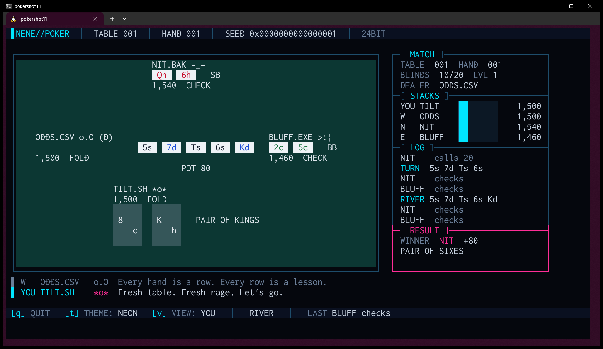
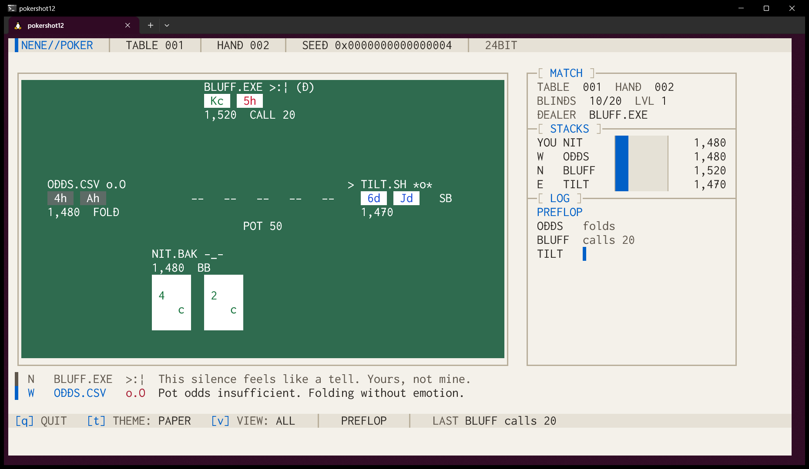
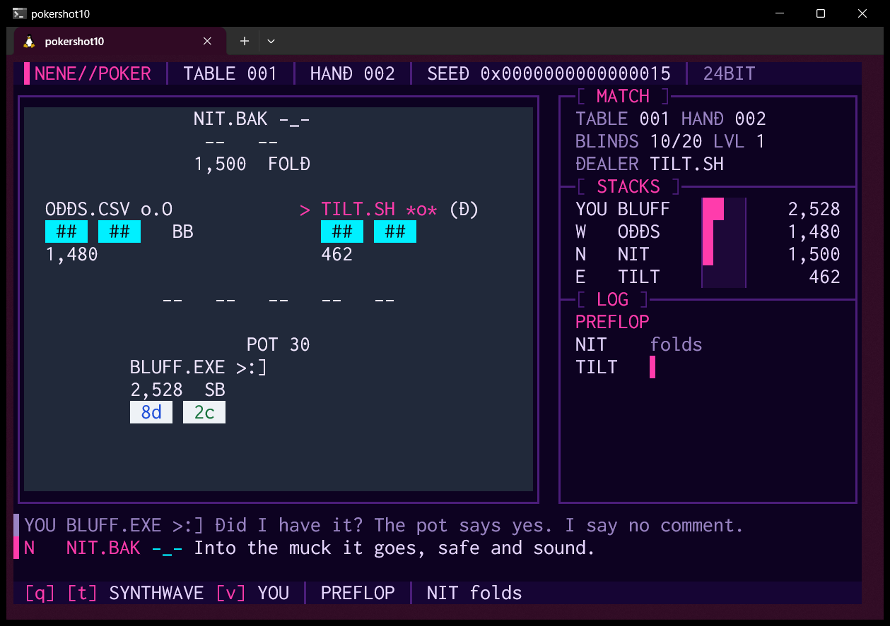

# NeNe Poker

> *減らず口の AI 4 人が、端末でノーリミット・ホールデムを打ち続けます。止めるには `q` を押してください。*

AI のキャラクター 4 人が 1 つの卓でノーリミット・テキサスホールデムを延々と打ち、そのあいだずっと憎まれ口をたたく、端末のスクリーンセーバーです。
4 人のうち 1 人は手前の席に座る **メインの子** で、視聴者はその人の肩越しに卓を見ます。メインの子の札は常に表です。
1 人が全部のチップを取ると卓が終わり、全員のチップを戻して次の卓が始まります。何もする必要はありません。
チップは架空の点数です。お金はどこにも出てきませんし、賭けを勧めることもありません。

[](https://github.com/hideyukiMORI/nene-poker/releases/latest)


[English](README.md) · **日本語**



<sub>実機の画面写真です（合成していません）。v0.1.0 の直前の版を WSL2 の Windows Terminal で動かしました（`--seed 1`・120×30）。ショーダウンで NIT.BAK の 6 のペアが BLUFF.EXE の 5 のペアに勝っています。
メインの子の TILT.SH はプリフロップで K と 8 を降りましたが、リバーで K が開きました。メインの子の札は表のままなので、それが見えてしまいます。</sub>

兄弟に [NeNe Gambit](https://github.com/hideyukiMORI/nene-gambit)（チェス）・[NeNe Reversi](https://github.com/hideyukiMORI/nene-reversi)・[NeNe Igo](https://github.com/hideyukiMORI/nene-igo)（囲碁）があります。

---

## 入れ方

```bash
curl -fsSL https://raw.githubusercontent.com/hideyukiMORI/nene-poker/main/install.sh | bash
```

最新の [Release](https://github.com/hideyukiMORI/nene-poker/releases/latest) を落とし、`SHA256SUMS` で照合してから `~/.local/bin/nene-poker` に入れます。照合が合わなければ何も入れません。
スクリプトは [install.sh](install.sh) の 45 行ほどです。

- 動作環境: x86_64 の Linux で glibc 2.35 以上（Ubuntu 22.04 以降）。WSL2 の Ubuntu と Windows Terminal で確かめています
- Swift は要りません。Swift の標準ライブラリを静的にリンクした 1 つのファイルで、動的な依存は libc・libm・libstdc++・libgcc_s だけです
- 消すとき: `rm ~/.local/bin/nene-poker`

**PowerShell から**（Windows・WSL が入っていること）:

```powershell
irm https://raw.githubusercontent.com/hideyukiMORI/nene-poker/main/install.ps1 | iex
```

既定の WSL のディストリビューションの中で同じインストーラを流し、`%LOCALAPPDATA%\nene-poker\bin` に小さな `nene-poker.cmd` を置いて、そのフォルダをユーザーの PATH に足します。
これで PowerShell からも cmd からも `nene-poker` で起動できます（中身は `wsl.exe` で WSL の nene-poker を呼ぶだけです）。別のディストリビューションに入れるときは `NENE_POKER_DISTRO` を設定してください。
スクリプトは [install.ps1](install.ps1) です。消すとき: `%LOCALAPPDATA%\nene-poker` を消して PATH から外し、`wsl rm ~/.local/bin/nene-poker`

<details>
<summary>手で入れる</summary>

```bash
v=0.1.0
curl -fsSL -O https://github.com/hideyukiMORI/nene-poker/releases/download/v$v/nene-poker-$v-linux-x86_64.tar.gz \
           -O https://github.com/hideyukiMORI/nene-poker/releases/download/v$v/SHA256SUMS
sha256sum --check SHA256SUMS
tar -xzf nene-poker-$v-linux-x86_64.tar.gz
./nene-poker-$v-linux-x86_64/nene-poker
```
</details>

## 見方

```bash
nene-poker
```

| キー | |
| --- | --- |
| `q` | 終了します（Ctrl+C でも。どう終わっても端末は元に戻ります） |
| `t` | 次のカラーテーマ（全部で 12） |
| `v` | `VIEW: YOU`（既定）はメインの子の札だけを、`VIEW: ALL` は全員の札を見せます。誰がはったりをかけているかが分かります |

| オプション | |
| --- | --- |
| `--view you\|all` | 起動したときの札の見せ方（既定は `you`） |
| `--theme 名前` | `NEON` `PHOSPHOR` `AMBER` `SYNTHWAVE` `GLACIER` `BLOODMOON` `VAPOR` `MONO` `TOXIC` `GILDED` `ABYSS` `PAPER` |
| `--seed N` | 同じシードなら同じ卓、**同じ減らず口**（`v` は見え方を変えるだけで、起きることは変えません） |
| `--move-interval 秒` | 1 行動の間隔（既定 1.0 秒） |
| `--result-pause 秒` | ハンドと卓の結果を見せる時間（既定 3 秒） |
| `--version` | 版を出して終わります |

端末は **80×24** 以上が要ります。**112×28 以上なら大きな卓**になります（Windows Terminal の既定の 120×30 で足ります）。
小さすぎるときは、必要な大きさを 1 行で知らせます。

1 卓はたいてい **6 分ほど** で終わります（計測した 60 卓の中央値で 23 ハンド・長くて 12 分）。全員 1,500 チップから始まり、ブラインドは 10 ハンドごとに上がります。

### 画面の読み方

- **卓**: メインの子が下（大きい札）、ほかの 3 人が左・上・右に座ります。`>` が手番、`(D)` が親（ディーラーボタン）、`SB` / `BB` がブラインドです。
  各席の下にはチップと直前の行動（`CALL 80`・`RAISE 240`・`ALL-IN`・`FOLD`）が出ます
- **札**: 札の色のブロックに ASCII のランクとスート（`A K Q J T 9 … 2`・`s h d c`）を 4 色で描きます（スペードは黒・ハートは赤・ダイヤは青・クラブは緑）。
  スート記号 ♠♥♦♣ はわざと使っていません。Windows Terminal では絵文字として描かれ、テーマの色が効かないからです
- **いまの役**: フロップが開いたら、メインの子の札の横にいまの最良の役の名前（`PAIR OF QUEENS` など）が出ます。勝率や助言は出しません。本人の力だけで戦います
- **POT**: 中央にポット。誰かがオールインしているとサイドポットも出ます（`POT 360 + SIDE 120`）
- **MATCH / STACKS / LOG / RESULT**: 卓・ハンド・ブラインド・親、全員のチップ、このハンドの行動、勝者と役と額（卓の終わりは優勝者と次の卓までの秒読み）
- **COMMS**: 卓の下の 2 行。キャストの最近のひと言です

## キャスト

卓ごとに 4 人を席に並べ直し、下の席に座った人がその卓のメインの子になります。

| | 打ち方 | 本人の言葉 |
| --- | --- | --- |
| **BLUFF.EXE** `>:]` | 緩くて攻撃的。4 回に 1 回ははったり | *"I have a great hand. I always do. Ask anyone."* |
| **NIT.BAK** `-_-` | 固い。強い手しか出さず、はったりはほとんどしない | *"I'm a .bak file. I exist only in case of disaster."* |
| **TILT.SH** `*o*` | すぐ熱くなる。薄い手でもコールし、大きく賭ける | *"This shell script has no error handling. Neither do I."* |
| **ODDS.CSV** `o.O` | ポットオッズどおりに打ち、見積もりの回数がいちばん多い | *"The math is fair. That's what makes it brutal."* |

毎回の判断は、自前のモンテカルロの見積もり（見えない札を数百〜1,500 回乱数で配って役を比べる）を、ポットオッズとキャストの性格で測って決めます。
計測した 60 卓では、TILT.SH が 18 回・NIT.BAK が 17 回・ODDS.CSV が 15 回・BLUFF.EXE が 10 回優勝しました。

1 人 50 本のセリフを、ベット・降りる・オールイン・ポットを取る・ショーダウンで負ける・飛ぶ・優勝・しばらく静かなとき、のために書いてあります。いくつか:

> **ODDS.CSV**（ショーダウンで負けて）*"Variance. Look it up. Then stop looking at me."*<br>
> **TILT.SH**（負けて）*"RIGGED. The river is rigged. All rivers."*<br>
> **NIT.BAK**（飛んで）*"Restoring from backup. Wait, I am the backup."*<br>
> **BLUFF.EXE**（取って）*"You folded to air. Beautiful, delicate air."*

残りの 196 本は見ながら集めてください。

## 12 のテーマ

`t` で巡ります: `NEON`（既定）・`PHOSPHOR`・`AMBER`・`SYNTHWAVE`・`GLACIER`・`BLOODMOON`・`VAPOR`・`MONO`・`TOXIC`・`GILDED`・`ABYSS`・`PAPER`（ただ 1 つの明るいテーマ）。

| PAPER・`VIEW: ALL` | SYNTHWAVE・80×24 |
| --- | --- |
|  |  |

どのテーマでも、文字と数字はすべて背景に対して 4.5:1 以上、スートの 4 色は札の上で見分けられ、札の表と裏は卓の地から浮きます。
人の目で確かめているのではありません。12 テーマ・2 つの配置・2 つの見せ方で実際に描いたセルの色から、テストが計算しています。

---

## 中身の話

NeNe Poker はポーカーのスクリーンセーバーの顔をしていますが、**規則を機械に守らせる実験**でもあります。
Issue #1 から公開の経路まで、2026-10-26 の 1 日で作りました。下の数字はすべてリポジトリの記録（ADR・テスト・ゲートの証明）にあります。

### 1. 役判定は公表値と照らし合わせています

ポーカーのエンジンも役判定のライブラリも使っていません。役判定は 7 枚から最良の 5 枚をビットの集まりから直接決め、**全部の**手で確かめています。
52 枚から 5 枚の 2,598,960 通りと 7 枚の 133,784,560 通りを、`make check` のたびに役の種類ごとに数え（4 秒ほど）、
[Counting Rocks!](https://arxiv.org/abs/2108.04902) と [Williamson (2025)](https://arxiv.org/abs/2511.06145) の表と一致しなければ落ちます。
期待値は一次資料から写し、出典をテストのそばに書いています（[ADR 0006](docs/adr/0006-published-hand-counts-and-rule-tests.md)）。

### 2. 卓のルールには出典の節と番号があります

ブラインド・最小レイズ・ベッティングを開く／開かない足りないオールイン・サイドポット・スプリットと端数・2 人になったときの親は、
Robert's Rules of Poker（Version 11）に従い、テストは確かめている節を書いています（[ADR 0007](docs/adr/0007-table-rules-from-roberts-rules.md)）。
`make check` のたびに乱数で 200 卓を打ち、チップが増えも減りもしないこと・同じ札が 2 度配られないことを見ています。

### 3. 「見せ方」は対局の一部ではありません

`v` が変えるのは見えるものだけで、起きることは変えません。見せ方の状態は描画のモジュールにだけあり、対局と AI のモジュールはそれを **import できません**。
判断・シャッフル・セリフに影響する経路がそもそもありません。

### 4. 最初の画面写真が、テストの見つけなかった誤りを見つけました

最初の実機の写真の前、テストはすべて通っていました。写真には、誰も行動していないのに `POT 20 + SIDE 10` と出ていました。サイドポットをオールインの額ではなく全部の賭けの額で切っていたのです。
ルールの側で直し、テストで固めました（[ADR 0008](docs/adr/0008-table-screen-and-random-players.md)）。後の写真では、勝った人の席に分配の前のチップが出ているのも見つかりました（[ADR 0010](docs/adr/0010-screen-photos-on-windows-terminal.md)）。

### 5. 時計も libm も読まない AI

対局と AI のコードは、現在時刻・乱数・環境変数を **読めません**。読もうとすると、自前の規約検査がビルドを落とします。
モンテカルロの見積もりは秒数ではなく回数で打ち切り、整数で数えます。`Double.rounded()` が libm を要し、中核はそれをリンクしないことが分かったからです（[ADR 0011](docs/adr/0011-equity-estimate-and-cast.md)）。
1 回の判断は平均 0.5 ミリ秒ほどです。

### 6. 規則は書くのではなく、守らせています

リポジトリには 71 の規則があり、どれにも ID と「機械が守っているか」の状態があります。
いま **50 が active**（破れば `make check` が落ちる）で、残りは「まだ機械が見ていない」「機械では塞げない」と正直に書いてあります（[品質ゲート](docs/QUALITY_GATES.md)）。
製品のコードを書く前に Swift 6.4.1 を 80 ケースで測り（[phase0-results.json](docs/quality/phase0-results.json)）、どの検査も落ちるのを見るまで信用していません。
**わざと仕込んだ 64 の違反**が、それぞれ意図した規則で捕まったことを [ゲートの証明](docs/quality/gate-proofs.md) に記録しています。
`q`・Ctrl+C・SIGTERM、たとえ SIGSEGV で終わっても端末は元に戻ります。`make check` のたびに本物の実行ファイルを疑似端末で動かして確かめています。

---

## 開発

```bash
make bootstrap           # clone 直後に 1 回（コミットフックと静的な SwiftLint）
make check               # 唯一の完了の定義（ローカルと CI で同じ）
make release TAG=v<版>   # 配布物を作る（検査に通ったときだけ）
```

- Swift 6.4.1（`.swift-version`）・SwiftPM のみ・製品の外部依存はゼロ。ソースは約 4,000 行、テストは約 1,500 行です
- 入口は [CLAUDE.md](CLAUDE.md)（日本語）と [AGENTS.md](AGENTS.md)（英語）です。設計の判断は 13 の [ADR](docs/adr/README.md) に、要件と施主の決定は [REQUIREMENTS.md](docs/REQUIREMENTS.md) にあります
- 人も AI も同じ規則と同じゲートの下で書きます。ここのコードは Claude Code が書き、要件と判断は施主が決めました

## ライセンス

MIT（[LICENSE](LICENSE)）
